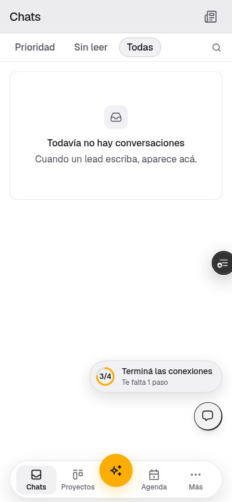
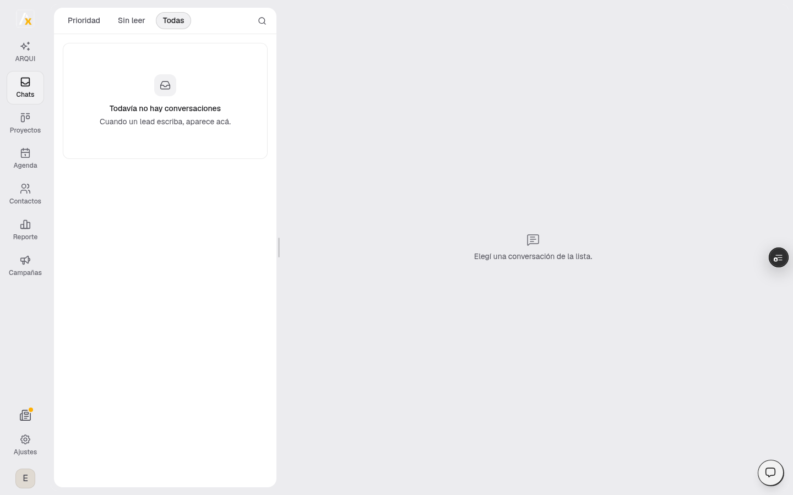
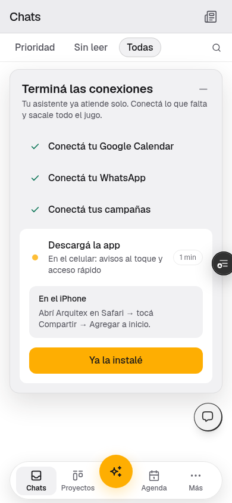

Cuando un [estudio](/glosario#estudio) se registra, Arquitex pide lo mínimo para que el [asistente](/glosario#asistente) pueda hablar. El wizard no es un formulario eterno: son siete pasos, en este orden.

[WhatsApp](/glosario#whatsapp) **no** es un paso del wizard. Se conecta después, en Inicio, cuando ya hay prueba activa o tarjeta.

## El wizard

<Steps>
  <Step title="Tu estudio">
    Nombre, ciudad, zona de trabajo, especialidad. Esto arma el perfil público y el contexto del asistente.
  </Step>
  <Step title="Tu oferta">
    La propuesta comercial por tipo de proyecto: qué incluye, precio de referencia, tiempos, tope. No es el filtro de calificación — es lo que el asistente puede cotizar o explicar cuando alguien pregunta.
  </Step>
  <Step title="Tu proyecto ideal">
    El [filtro](/glosario#filtro): zona, tipo de proyecto, metros, presupuesto. Lo que el asistente usa para calificar. Se puede cambiar después en Ajustes.
  </Step>
  <Step title="Tu asistente IA">
    Nombre, tono, qué puede y qué no puede decir. Es quien le habla al lead por WhatsApp. ARQUI es otra cosa: te habla a vos, adentro del panel.
  </Step>
  <Step title="Tu calendario">
    Conectás Google Calendar y definís horarios. Sin esto el asistente no puede agendar.
  </Step>
  <Step title="Campañas y tu web">
    Subís la galería de obras (las mismas fotos sirven para la [web](/glosario#web) y para los anuncios) y decís si querés pautar. La web en `{slug}.arquitex.app` es opcional, salvo que vayas a correr anuncios de Google: ahí la landing publicada es requisito.
  </Step>
  <Step title="Revisión">
    Un resumen de lo que configuraste. **Activar** arranca la prueba.
  </Step>
</Steps>

<Note>
  Activar no conecta WhatsApp. Te lleva a Inicio: primero la prueba (o la tarjeta), después WhatsApp, el calendario si faltara, y opcionalmente Meta.
</Note>

## Después de Activar: Inicio {#despues-de-activar-inicio}

La pantalla se llama **Casi listo**. El orden es este:

1. **Prueba o tarjeta.** Conectar WhatsApp pide una suscripción activa o una prueba en curso. Sin eso, el botón de WhatsApp no arranca.
2. **WhatsApp.** OAuth de Meta. El número deja de funcionar en la app de WhatsApp Business del celular: tiene que ser un número dedicado. Arquitex no vende líneas gestionadas desde el panel.
3. **Calendario**, si todavía no lo conectaste en el wizard.
4. **Meta**, si querés ver pauta o lanzar campañas. Se puede saltear.
5. **Descargá la app**, solo en el celular. Es el cuarto paso del stepper **Terminá las conexiones**, después de Calendar, WhatsApp y Campañas.

El estudio pasa a activo con WhatsApp y calendario. **Descargá la app** no frena ese paso.

Es de cada persona del estudio. En el celular instalás Arquitex, o tocás **Ya la instalé**. Queda marcado en cualquier dispositivo. Si era lo único que faltaba, la pastilla desaparece.

En el celular, si lo único que falta es la app, la pastilla dice **Te falta 1 paso**.

<Frame caption="En el celular. Si solo falta la app, la pastilla dice Te falta 1 paso.">
  
</Frame>

En la compu el paso no aparece: ni aviso ni QR. Si lo único que falta es la app, el stepper tampoco.

<Frame caption="En la compu, si solo falta la app, no hay pastilla ni stepper.">
  
</Frame>

En **Cómo instalarla**: en el iPhone, abrí Arquitex en Safari → tocá Compartir → Agregar a inicio. En Android, el aviso del navegador o el menú → Instalar app. Si abrís Arquitex desde Instagram o Facebook, abrilo en Safari o Chrome.

<Frame caption="En el iPhone: Safari, Compartir, Agregar a inicio.">
  
</Frame>

<Tip>
  Si salteás Meta en Inicio, lo conectás después en [Campañas](/panel/campanas) o en [Ajustes → Campañas](/estudio/configuracion).
</Tip>

## El primer lead

Cuando alguien te escribe:

1. El asistente responde.
2. Califica según tu filtro.
3. Si califica, ofrece horarios y confirma.
4. Vos ves la conversación en [Chats](/panel/inbox) y el proyecto en [Proyectos](/panel/pipeline).

Si el [lead](/glosario#lead) no avanza, ARQUI te lo pone en [ARQUI](/panel/acciones).

## Qué no hace el onboarding

- No te pide pixel, token ni CAPI pegados a mano.
- No te hace comprar una línea de WhatsApp.
- No te obliga a publicar la web, salvo que quieras anuncios de Google.
- No te deja en un CRM vacío: el asistente ya puede hablar.

## Después

<Columns>
  <Card title="ARQUI" icon="list-check" href="/panel/acciones">
    La cola de lo urgente.
  </Card>
  <Card title="Campañas" icon="megaphone" href="/panel/campanas">
    Conectar Meta y lanzar pauta.
  </Card>
  <Card title="Planes" icon="credit-card" href="/estudio/planes">
    Solo, Equipo y Escala.
  </Card>
</Columns>
