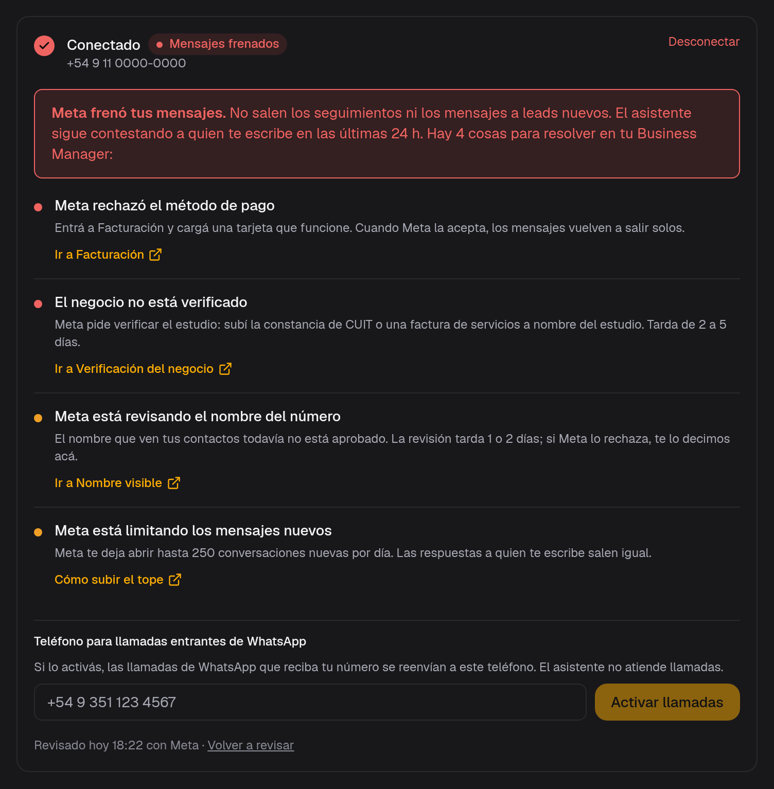
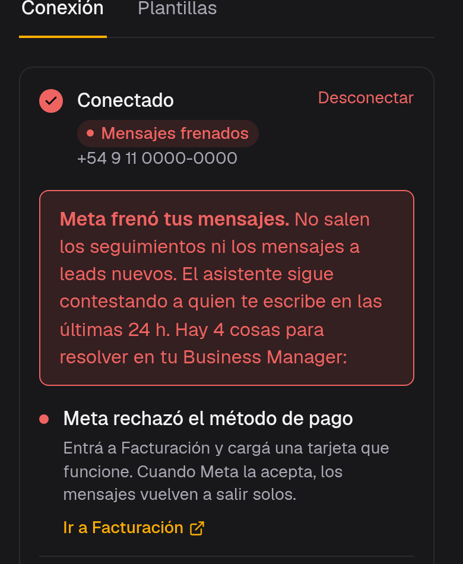

[WhatsApp](/glosario#whatsapp) es el canal por el que el [asistente](/glosario#asistente) le habla al lead. Se configura en **Ajustes → WhatsApp**, con dos secciones: **Conexión** y **[Plantillas](/glosario#plantilla)**.

No es un paso del wizard. Se conecta en **Inicio**, después de Activar, cuando ya hay prueba activa o tarjeta. Sin suscripción activa (o prueba en curso), el botón de conectar no arranca.

## Conexión

OAuth de Meta. El número deja de funcionar en la app de WhatsApp Business del celular: tiene que ser un **número dedicado**. Arquitex no vende líneas gestionadas desde el panel.

Solo el dueño puede conectar o desconectar. Desconectar deja al estudio sin bot, sin chats, sin recordatorios y sin seguimientos. El resto del equipo ve el estado en modo lectura.

Al lado de **Conectado** está la [salud de la cuenta](#salud).

<Note>
Conectar WhatsApp pide prueba activa o tarjeta. El wizard termina en Activar; Inicio es el lugar donde se engancha el número.
</Note>

## Salud de la cuenta de WhatsApp {#salud}

En **Ajustes → WhatsApp → Conexión**, al lado de **Conectado**, hay un cartel con lo que Meta dice de la cuenta.

Si Arquitex todavía no consultó a Meta, el cartel no aparece.

<Frame caption="Cuenta de demostración: el número y los datos son inventados. En rojo se ven el aviso y cuatro problemas, cada uno con su link.">
  
</Frame>

<Frame caption="La misma cuenta de demostración, en el celular. Se ve el cartel y el primer problema.">
  
</Frame>

### Verde, amarillo y rojo

**Verde. Todo en orden.** Una línea, sin lista. Meta no marca ningún problema. Salen las respuestas, los seguimientos y los mensajes a leads nuevos.

**Amarillo. Revisar.** Por ahora todo sale: siguen las respuestas, los seguimientos y los mensajes a leads nuevos. Si esto sigue, Meta puede empezar a frenar mensajes. Debajo, un renglón por cada cosa a atender.

**Rojo. Mensajes frenados.** Meta frenó tus mensajes. No salen los seguimientos ni los mensajes a leads nuevos. El asistente sigue contestando a quien te escribe en las últimas 24 h. Si hay una sola cosa, el aviso dice «Hay 1 cosa para resolver en tu Business Manager». Si hay varias, dice cuántas.

Puede haber más de un problema a la vez. En la captura hay cuatro.

### Qué puede marcar Meta

Casi siempre se resuelve en el [Business Manager](/glosario#business-manager) de Meta, con el link de ese renglón. La lista muestra solo lo que Meta está marcando ahora.

| Problema | Qué hacer | El link |
|---|---|---|
| **Meta rechazó el método de pago** | Entrá a Facturación y cargá una tarjeta que funcione. Cuando Meta la acepta, los mensajes vuelven a salir solos. Esa Facturación es la de Meta. | Ir a Facturación |
| **El negocio no está verificado** | Meta pide verificar el estudio: subí la constancia de CUIT o una factura de servicios a nombre del estudio. Tarda de 2 a 5 días. | Ir a Verificación del negocio |
| **Meta está revisando el nombre del número** | El nombre que ven tus contactos todavía no está aprobado. La revisión tarda 1 o 2 días; si Meta lo rechaza, te lo decimos acá. | Ir a Nombre visible |
| **Meta no aprobó el nombre del número** | El nombre que ven tus contactos tiene que parecerse al del estudio o tu marca. Cambialo y esperá la revisión (1 o 2 días). | Ir a Nombre visible |
| **La calidad del número bajó** | Varios contactos bloquearon o marcaron como spam tus mensajes esta semana. Revisá que las plantillas vayan solo a gente que te escribió antes. | Ver calidad en Business Manager |
| **La calidad del número está en rojo** | Muchos contactos bloquearon o marcaron como spam tus mensajes. Pausá las campañas y revisá a quién le mandás plantillas. | Ver calidad en Business Manager |
| **Meta está limitando los mensajes nuevos** | Meta te deja abrir hasta una cantidad de conversaciones nuevas por día. Si informa el tope, el texto trae el número. Si no, dice que hay un tope, sin la cifra. Las respuestas a quien te escribe salen igual. | Cómo subir el tope |
| **Meta marcó el número para revisar** | Entrá a la cuenta de WhatsApp en Business Manager para ver qué pide Meta. | Ir a WhatsApp Manager |
| **Meta bloqueó el número** | Entrá a la cuenta de WhatsApp en Business Manager para ver el motivo y pedir una revisión. | Ir a WhatsApp Manager |
| **Meta frenó la cuenta de WhatsApp** | Meta no dice la causa por acá. Si manda un código, aparece entre paréntesis. En Business Manager, la cuenta de WhatsApp muestra el aviso y qué pide. | Ir a WhatsApp Manager |

**Cómo subir el tope** abre la página de Meta sobre ese límite. El resto de los links abre Business Manager.

### Cuándo se revisa

Arquitex revisa una vez por día, a las 8:30 (hora de Argentina), y también cuando abrís la página.

Al pie se lee **Revisado hoy HH:MM con Meta · Volver a revisar**. La hora es la de esa revisión. En la captura de demostración dice «Revisado hoy 18:22 con Meta». **Volver a revisar** pide el estado de nuevo en ese momento.

### Si pasa a rojo

Al dueño del estudio le llega un mail y una notificación push.

El título es **Meta frenó los mensajes de tu WhatsApp**. El mail nombra los problemas en rojo y cierra con: «En Configuración → WhatsApp está qué resolver en tu Business Manager.» El botón dice **Ver qué resolver**. El push abre la misma pantalla.

## Plantillas

Los mensajes de seguimiento que el asistente manda a los leads que todavía no agendaron. Hay una secuencia por tipo de consulta, con pasos espaciados: inmediato, +6 horas, +1 día, +3, +7, +10 días y seguimiento mensual. Podés editar cada texto.

Cada cambio se re-envía a WhatsApp para aprobación de Meta — puede demorar unas horas. El estado (*Aprobada*, *En revisión*, *Rechazada*) se ve en la misma pantalla. No toques las variables `{{1}}`, `{{2}}`: son los datos que se completan solos.

Las plantillas se aprueban contra la cuenta de WhatsApp del número. Si el número cambia, hay que volver a aprobarlas.

<Tip>
`/configuracion/plantillas` redirige a `/configuracion/whatsapp?seccion=plantillas`. No hay un ítem suelto de Plantillas en el menú de Ajustes.
</Tip>

El costo de envío de plantillas lo cobra Meta. Lo ves en Facturación → **Consumo**. Detalle de planes en [Planes](/estudio/planes).

Las de **Primer contacto** son las que mandás vos cuando el lead todavía no tiene conversación. Se eligen en [Iniciar conversación](/panel/pipeline#iniciar-conversacion), desde Proyectos o desde Contactos. También es un mensaje pago de WhatsApp. Si no hay ninguna aprobada, la ventana lo dice.

## Crear tus propias plantillas {#crear-tus-propias-plantillas}

En los grupos **Primer contacto** y **Reapertura** podés sumar plantillas del estudio, además de la de fábrica. Están en la misma pantalla: **Ajustes → WhatsApp → Plantillas**.

Solo los administradores del estudio ven **Nueva plantilla**. El resto del equipo no.

<Steps>
  <Step title="Ponéle nombre y texto">
    **Nueva plantilla** abre el mismo editor lateral de siempre. El nombre es el que después ves en el selector.
  </Step>
  <Step title="Queda debajo de la de fábrica">
    Aparece en la lista del grupo. Muestra quién la creó y cuándo — «Creada por … el 22/10» — y tiene **Duplicar** y **Eliminar**. **Eliminar** pide confirmación.
  </Step>
  <Step title="Elegila cuando esté aprobada">
    En [Iniciar conversación](/panel/pipeline#iniciar-conversacion), el selector muestra las aprobadas de **Primer contacto**, cada una con su nombre.
  </Step>
</Steps>

<Note>
Pasan por la misma aprobación de WhatsApp (Meta) que las de fábrica. Si todavía no está aprobada, en la lista se ve el estado. Puede demorar unas horas.
</Note>

<Note>
Tope de 10 propias por grupo: WhatsApp limita cuántas plantillas puede tener cada número. Al llegar al tope, **Nueva plantilla** queda apagado y explica por qué.
</Note>

<Note>
Si una propia ya está aprobada y se está usando, no se edita. El botón dice **Duplicar para cambiarla**: el cambio se hace en la copia.
</Note>
